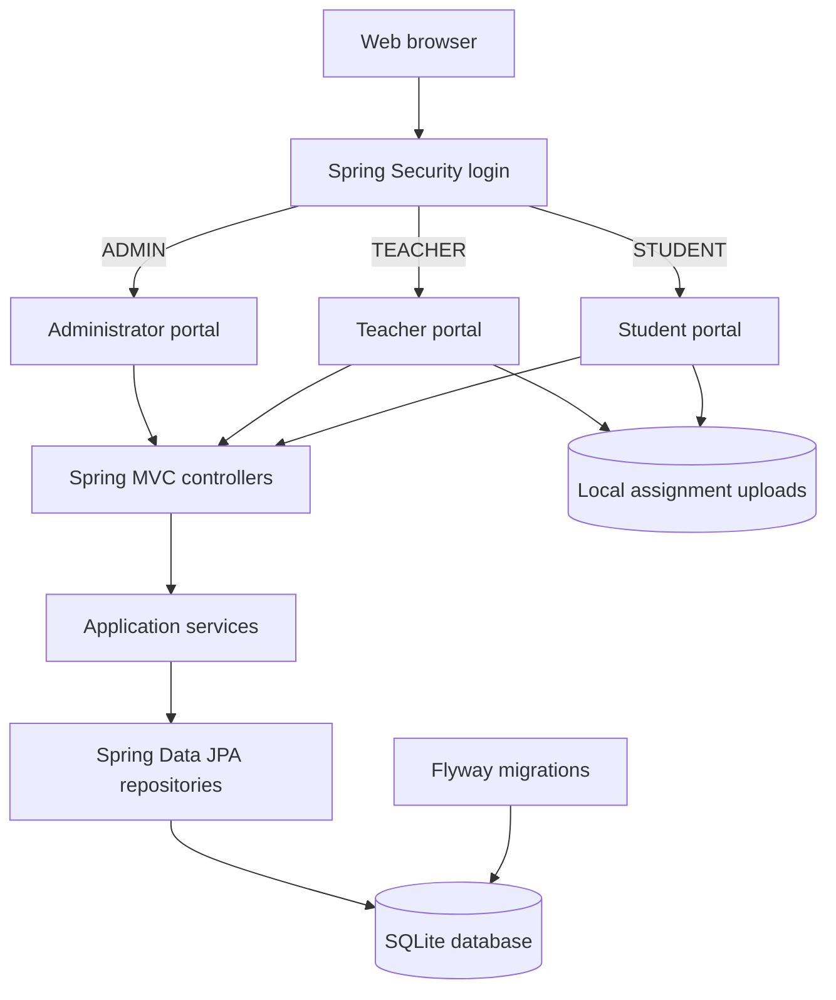

# Student Management System

A role-based school management web application built with Spring Boot, Spring Security, Thymeleaf, JPA, and SQLite. The application serves administrator, teacher, and student portals from one Spring Boot process.

## Requirements

- Java 21 JDK
- A terminal with access to the project directory
- Network access on the first Maven Wrapper run if Maven must be downloaded

Set `JAVA_HOME` to the installed JDK 21 directory and ensure its `bin` directory is on `PATH`. The Maven Wrapper (`mvnw` / `mvnw.cmd`) is included, so a separate Maven installation is not required.

## Setup

1. **Configure Java.** In PowerShell, point `JAVA_HOME` to your JDK 21 installation (replace the example path with the actual installation directory):

   ```powershell
   $env:JAVA_HOME = "C:\Program Files\Java\jdk-21"
   $env:Path = "$env:JAVA_HOME\bin;$env:Path"
   ```

   On macOS or Linux, set `JAVA_HOME` to the JDK 21 installation directory and add `$JAVA_HOME/bin` to `PATH`.

2. **Open the project root.** This is the directory containing `pom.xml` and `mvnw.cmd`.

3. **Configure the first administrator password before the first launch.** The application does not use a default password. In PowerShell:

   ```powershell
   $env:SMS_ADMIN_PASSWORD = "choose-a-strong-password"
   ```

   The default administrator username is `admin`; it can be changed with `SMS_ADMIN_USERNAME`. The account is created only when the database has no administrator. Changing these variables after an administrator exists does not reset that account's password.

4. **Start the application.** On Windows PowerShell:

   ```powershell
   .\mvnw.cmd spring-boot:run
   ```

   On macOS or Linux:

   ```bash
   export SMS_ADMIN_PASSWORD='choose-a-strong-password'
   ./mvnw spring-boot:run
   ```

5. **Sign in.** Open [http://localhost:8080/login](http://localhost:8080/login) and sign in with the configured administrator username and password.

6. **Create school users and records.** Use the administrator portal to set up teachers, students, classes, and subjects. Users are redirected to a dashboard according to their assigned role.

On first startup, Flyway creates and updates the SQLite schema. By default, the database file is `sms.db` in the working directory, and uploaded assignment files are stored under `uploads/`.

Demo records are enabled by default for local development. The application fills the database up to 21 students and 3 teachers without replacing existing records, creates the `BCA-SEM-5` class if needed, and assigns sample subjects to teachers. Set `SMS_DEMO_DATA_ENABLED=false` to disable demo seeding. Generated demo accounts use `SMS_DEMO_PASSWORD` (default: `DemoPass123!`); change it before sharing the app, and disable demo data outside local development.

Generated demo usernames use the `demo-teacher-NN` and `demo-student-NN` patterns. In the existing local database, the additional accounts are `demo-teacher-01` and `demo-teacher-02`, plus `demo-student-01` through `demo-student-20`.

## Configuration

Configuration can be supplied through environment variables; defaults are shown below.

| Variable | Default | Purpose |
| --- | --- | --- |
| `DB_URL` | `jdbc:sqlite:./sms.db?foreign_keys=on` | JDBC URL for the SQLite database |
| `SMS_UPLOADS_DIR` | `./uploads` | Directory for uploaded assignment files |
| `SMS_SCHOOL_NAME` | `Student Management System` | School name printed on report cards and ID cards |
| `SMS_ADMIN_USERNAME` | `admin` | Username for the first seeded administrator |
| `SMS_ADMIN_EMAIL` | `admin@school.local` | Email for the first seeded administrator |
| `SMS_ADMIN_PASSWORD` | *(empty)* | Password for first-admin creation; must be set if no admin exists |

Uploads are limited to 10 MB. Accepted extensions are PDF, DOC, DOCX, TXT, JPG, JPEG, PNG, and ZIP. Uploaded files are stored under generated names and served through access-controlled application routes.

## Functionality

- **Administrator:** Manage teachers, students, classes, and subjects; publish announcements; view dashboards; generate reports, report cards, and ID cards.
- **Teacher:** View assigned classes and students; mark attendance; enter grades; create assignments and review submissions; publish announcements; view reports.
- **Student:** View profile, attendance, grades, assignments, and announcements; submit assignment files.
- **Authentication and access control:** Form-based sign-in, BCrypt password hashing, role-specific dashboard redirects, and route restrictions for administrator, teacher, and student areas.

## Application Flow



## Run Tests

On Windows:

```powershell
.\mvnw.cmd test
```

On macOS or Linux:

```bash
./mvnw test
```

## Main Project Areas

- `src/main/java/com/sms/` - application code, separated into authentication, administration, teacher, student, reporting, and shared components
- `src/main/resources/templates/` - Thymeleaf pages for each portal
- `src/main/resources/db/migration/` - Flyway schema migrations
- `src/test/java/com/sms/` - application and feature tests
